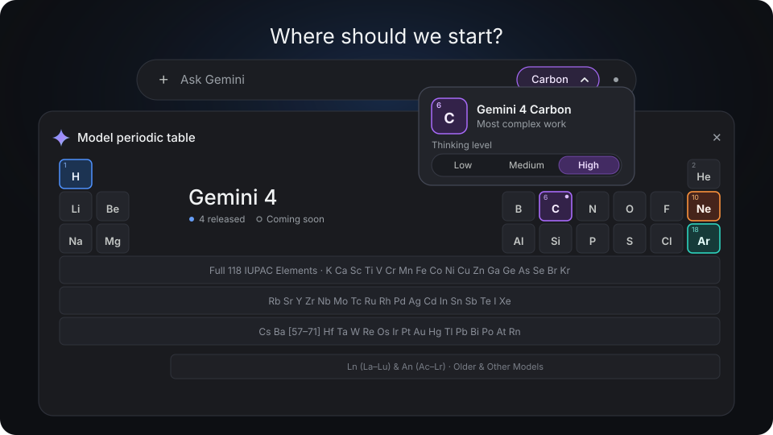

# ✦ Model Periodic Table — Gemini & Antigravity Plugin

<p align="center">
  
</p>

An interactive **118-element Periodic Table** model selector for **Gemini Web (`gemini.google.com`)** and **Google Antigravity** — inspired by the Gemini 4 chemical element naming scheme (**Hydrogen**, **Carbon**, **Argon**).

在一个完整的 **118 元素周期表** 上丝滑切换 **Gemini 4** 与 **Antigravity** 模型（支持 **Hydrogen 氢**、**Carbon 碳**、**Argon 氩** 三大已发布元素模型 + `Low / Medium / High / XHigh` 思考深度切换 + 其余 115 种 `Coming soon` 彩蛋元素卡片预览）。

---

## ✨ Features / 功能亮点

- **Full 118-Element IUPAC Grid**: Every element from `1 H` (Hydrogen) to `118 Og` (Oganesson), including Lanthanides (`Ln 57–71`) and Actinides (`An 89–103`).
- **3 Released Gemini 4 Element Models**:
  - **`1 H` — Gemini 4 Hydrogen** (*Everyday help*) · Blue theme · `Low / Medium / High` (+ `XHigh` in Antigravity)
  - **`6 C` — Gemini 4 Carbon** (*Most complex work*) · Purple theme · `Low / Medium / High`
  - **`18 Ar` — Gemini 4 Argon** (*Code and analysis*) · Teal theme · `Low / Medium / High`
- **115 "Coming Soon" Elements**: Click any unreleased element (`26 Fe` Iron, `48 Cd` Cadmium, `79 Au` Gold, etc.) for its floating element popover and playful `○ Element ⌄` badge preview.
- **Older & Other Models Bar**: Quick one-click chips for `3.1 Flash-Lite`, `3.1 Pro` on Gemini Web, and `Gemini 3.8 Flash`, `Orchestrator`, `Claude Sonnet 4.6`, `Claude Opus 4.6`, `GPT-OSS 120B` in Antigravity.
- **Keyboard Type-to-Jump**: While the Periodic Table is open, type any chemical symbol (`Fe`, `Ar`, `Au`, `C`) to highlight and jump straight to that element; press `Alt + P` to toggle anytime.

---

## 🚀 Installation / 安装指南

### 1. Google Antigravity Plugin (原生侧边栏插件 + `/periodic-model-picker` 技能)

Clone directly into Antigravity's plugins directory (or run the installer script):

```bash
git clone https://github.com/BACKSPACEGH/periodic-model-picker.git \
  ~/.gemini/config/plugins/periodic-model-picker
```

Or from a local checkout (works even without global `npm` installed):

```bash
./install.sh
```

Once installed:
1. Open **Customizations → Plugins → Model Periodic Table** (enabled automatically).
2. Type `/periodic-model-picker` in chat (or open **Model Periodic Table** in the Auxiliary Side Pane) to pick any Gemini 4 element model + thinking level and launch new conversations or switch swarm models!

---

### 2. Gemini Web — Chrome / Edge / Arc / Brave Extension (`gemini.google.com`)

1. Open `chrome://extensions` (or `edge://extensions`).
2. Enable **Developer mode (开发者模式)** in the top-right corner.
3. Click **Load unpacked (加载已解压的扩展程序)** and select the [`chrome-extension/`](./chrome-extension) folder in this repository.
4. Visit [`https://gemini.google.com`](https://gemini.google.com) and click the model pill (`Hydrogen ⌄`) in the prompt bar — or press **`Alt + P`**!
   - *Tip*: Hold `Shift` while clicking the native model button if you ever want to open Gemini's original dropdown menu.

---

### 3. Tampermonkey / Violentmonkey / Userscripts (`userscript/`)

Prefer a lightweight Userscript? Install [`userscript/gemini-periodic-table.user.js`](./userscript/gemini-periodic-table.user.js) in Tampermonkey, Violentmonkey, or Safari Userscripts — zero configuration needed.

---

### 4. Standalone Interactive Demo (`docs/`)

Open [`docs/index.html`](./docs/index.html) directly in any browser (or enable **GitHub Pages** from `main` → `/docs`) to experience the full `"Where should we start?"` + `✦ Model periodic table` interface standalone.

---

## 🛠️ Development & Verification

Zero external `npm` dependencies required (runs on Node.js 18+):

```bash
# Sync shared modules into chrome-extension/, docs/, and userscript/ + render icons
npm run build

# Run automated verification suite (118 elements, layout coordinates, manifests, sidecar server)
npm test

# Preview the Antigravity sidecar locally at http://127.0.0.1:17940
npm run preview:sidecar
```

## 📄 License

MIT
